# Reinforcement learning on classic control, LunarLander and Atari Pong

Tabular Q-learning, DQN, PPO and DDPG, each in one `train.py`.

```bash
uv sync
uv run python 03_ppo/train.py --env acrobot --live --snapshots 5
```

`--env cartpole|acrobot|lunarlander|pong` · `--live` live plot · `--snapshots N` videos during training · `--watch` watch the trained agent

## Results

| Game | Goal | Algorithm | Final return |
|---|---|---|---|
| CartPole | keep the pole up (max 500) | Q-learning · DQN · PPO | 454 · 500 · 450 |
| Acrobot | swing the tip above the line, fast (solved at −100) | DQN · PPO | −82 · −76 |
| Pendulum | swing up and hold (solved ≈ −150) | DDPG | −114 |
| LunarLander | land between the flags (solved at 200) | DQN · PPO | 281 · 220 |
| Pong (Atari, from pixels) | beat the built-in opponent to 21 (max +21) | DQN · PPO | +20.0 · +19.6 |

### CartPole

<p align="center">
  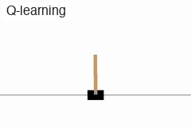
  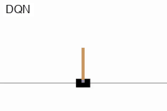
  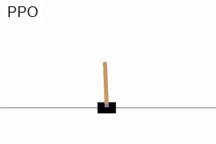
</p>
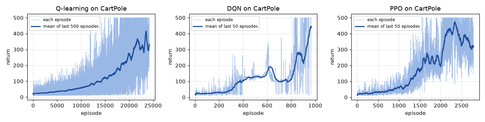

### Acrobot

<p align="center">
  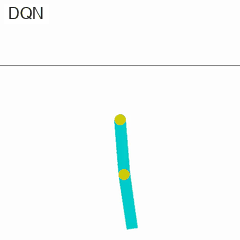
  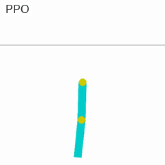
</p>
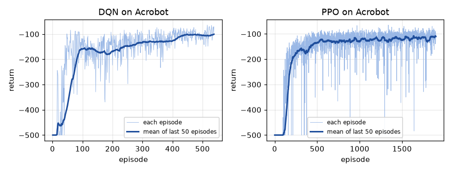

### Pendulum

<p align="center">
  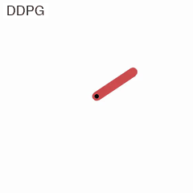
</p>
<p align="center">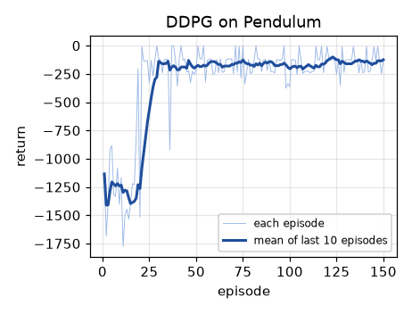</p>

### LunarLander

<p align="center">
  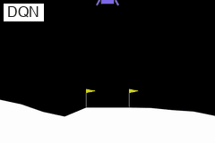
  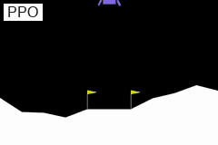
</p>
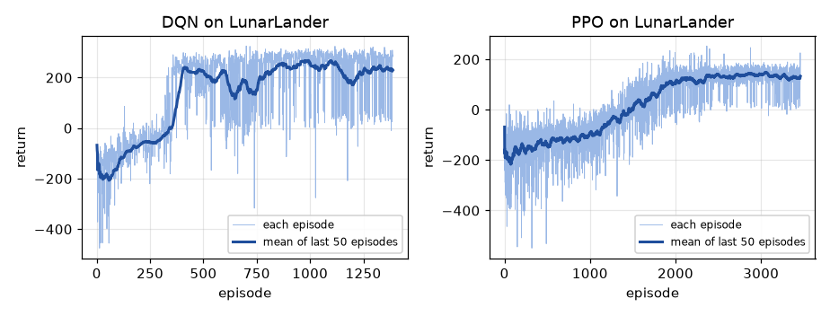

### Pong

<p align="center">
  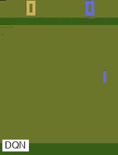
  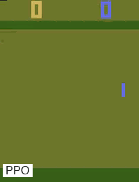
</p>
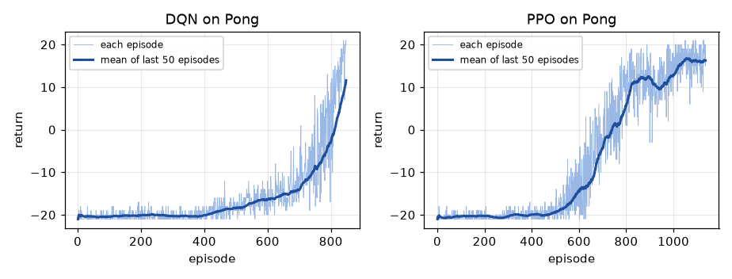

## Algorithms

$s_t, a_t, r_t$ are the state, action and reward at step $t$; $d_t = 1$ when the episode ends for real (not a time limit); $\gamma = 0.99$.

**Tabular Q-learning** — a table of values, nudged toward the TD target:

```math
Q(s_t,a_t) \leftarrow Q(s_t,a_t) + \alpha\big[r_t + \gamma(1-d_t)\max_{a} Q(s_{t+1},a) - Q(s_t,a_t)\big]
```

**DQN** — a network $Q_\theta$ trained on batches from a replay buffer $\mathcal{D}$, against a frozen copy $Q_{\theta^-}$ that is copied over every $C$ steps:

```math
\mathcal{L}(\theta) = \mathbb{E}_{(s_t,a_t,r_t,s_{t+1},d_t)\sim\mathcal{D}}\Big[\text{Huber}\big(r_t + \gamma(1-d_t)\max_{a} Q_{\theta^-}(s_{t+1},a) - Q_\theta(s_t,a_t)\big)\Big]
\qquad
\theta^- \leftarrow \theta \ \text{ every } C \text{ steps}
```

**PPO** — an actor $\pi_\theta$ picks actions, a critic $V_\phi$ predicts the return. All averages are over the collected batch.

The critic's surprise at each step gives the advantage $A_t$ (GAE, computed backwards) and the return target $R_t$:

```math
\delta_t = r_t + \gamma(1-d_{t+1}) V_\phi(s_{t+1}) - V_\phi(s_t)
\qquad
A_t = \delta_t + \gamma\lambda(1-d_{t+1}) A_{t+1}
\qquad
R_t = A_t + V_\phi(s_t)
```

Actor (clipped) and critic (regression to $R_t$), trained together with an entropy bonus $\mathcal{H}$ that keeps it exploring:

```math
\rho_t = \frac{\pi_\theta(a_t\mid s_t)}{\pi_{\text{old}}(a_t\mid s_t)}
\qquad
\mathcal{L}_{\text{actor}}(\theta) = - \mathbb{E}_t\Big[\min\big(\rho_t A_t,\ \text{clip}(\rho_t, 1-\epsilon, 1+\epsilon) A_t\big)\Big]
```

```math
\mathcal{L}_{\text{critic}}(\phi) = \mathbb{E}_t\Big[\big(V_\phi(s_t) - R_t\big)^2\Big]
\qquad
\mathcal{L} = \mathcal{L}_{\text{actor}} + c_1 \mathcal{L}_{\text{critic}} - c_2 \mathbb{E}_t\big[\mathcal{H}[\pi_\theta(\cdot\mid s_t)]\big]
```

**DDPG** — for continuous actions: an actor $\mu_\phi(s)$ outputs the action, a critic $Q_\theta$ scores it, both trained on batches from $\mathcal{D}$, with target copies $Q_{\theta^-}$ and $\mu_{\phi^-}$:

```math
\mathcal{L}(\theta) = \mathbb{E}_{(s_t,a_t,r_t,s_{t+1},d_t)\sim\mathcal{D}}\Big[\big(Q_\theta(s_t,a_t) - r_t - \gamma(1-d_t) Q_{\theta^-}(s_{t+1}, \mu_{\phi^-}(s_{t+1}))\big)^2\Big]
\qquad
\mathcal{L}(\phi) = - \mathbb{E}_{s_t\sim\mathcal{D}}\big[Q_\theta(s_t, \mu_\phi(s_t))\big]
```

The target networks follow slowly after every step (soft update, $\tau = 0.005$):

```math
\theta^- \leftarrow \tau \theta + (1-\tau) \theta^-
\qquad
\phi^- \leftarrow \tau \phi + (1-\tau) \phi^-
```

## Layout

`01_q_learning/` `02_dqn/` `03_ppo/` `04_ddpg/` one `train.py` each · `rlkit/` plots, videos, logging ·
`check.py` quick tests · `assets/` images above (rebuild: `uv run python -m rlkit.media`)
